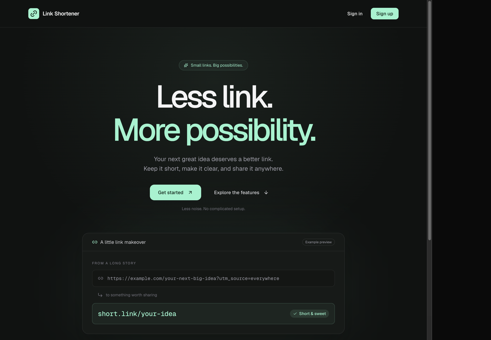
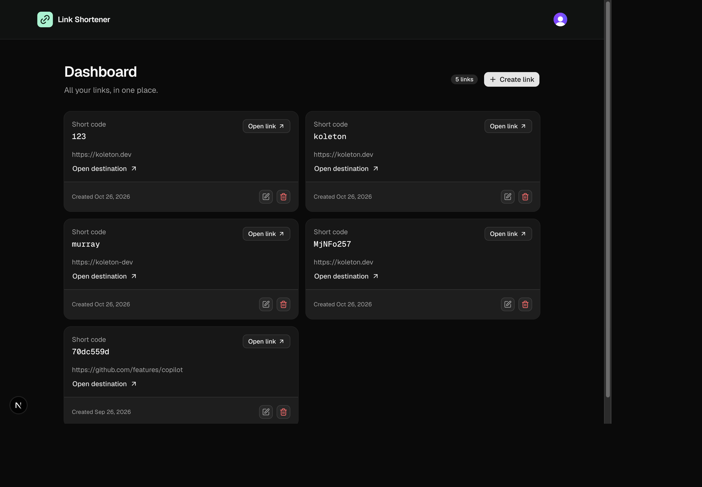
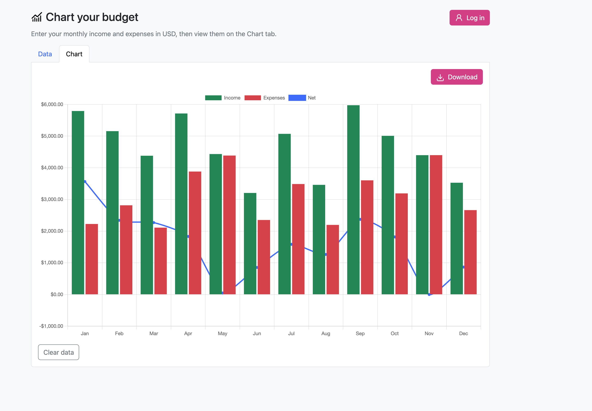
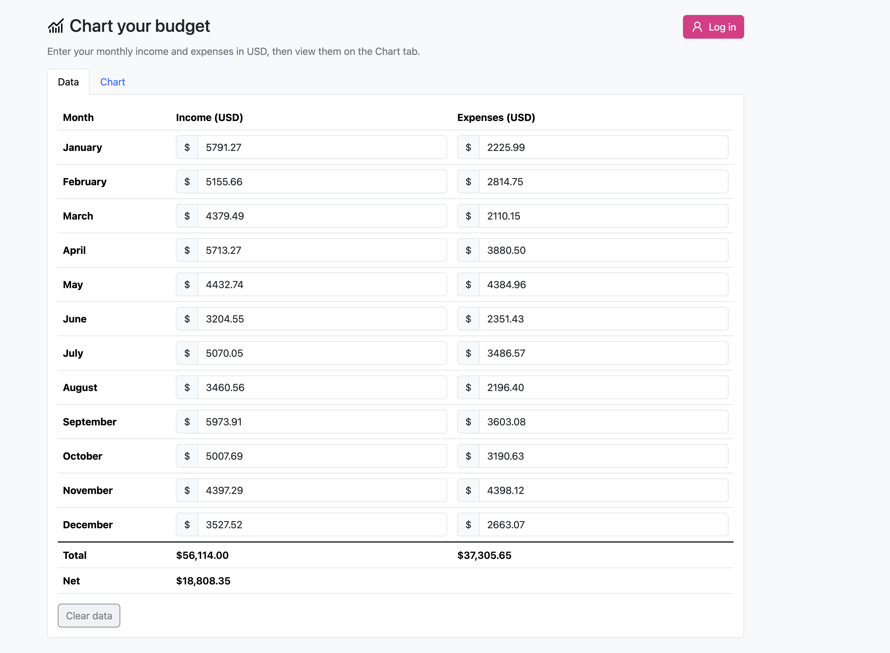

# GitHub Copilot: Beginner to Pro

My implementation of the projects and exercises from the [GitHub Copilot course on Udemy](https://www.udemy.com/course/github-copilot/?couponCode=MT261026G2).

The projects progress from small Python scripts to a static web app and a full-stack application, exploring Copilot-assisted development along the way.

## Projects

| Project | Overview | Stack |
| --- | --- | --- |
| [Link Shortener](./link-shortener-project/README.md) | Accounts, private link management, custom slugs, and public redirects | Next.js, TypeScript, Clerk, Drizzle, Neon Postgres, shadcn/ui |
| [Chart your budget](./chart-your-budget/README.md) | Monthly income and expenses, totals, interactive charts, and PNG export | JavaScript, Bootstrap, Chart.js |
| [Python exercises](./random-code-snippets/README.md) | Rock, Paper, Scissors, monthly finance generation, and password-strength checking | Python 3 |

Each project runs independently. See its README for setup, usage, and tests.

## App screenshots

### Link Shortener

### Chart your budget

