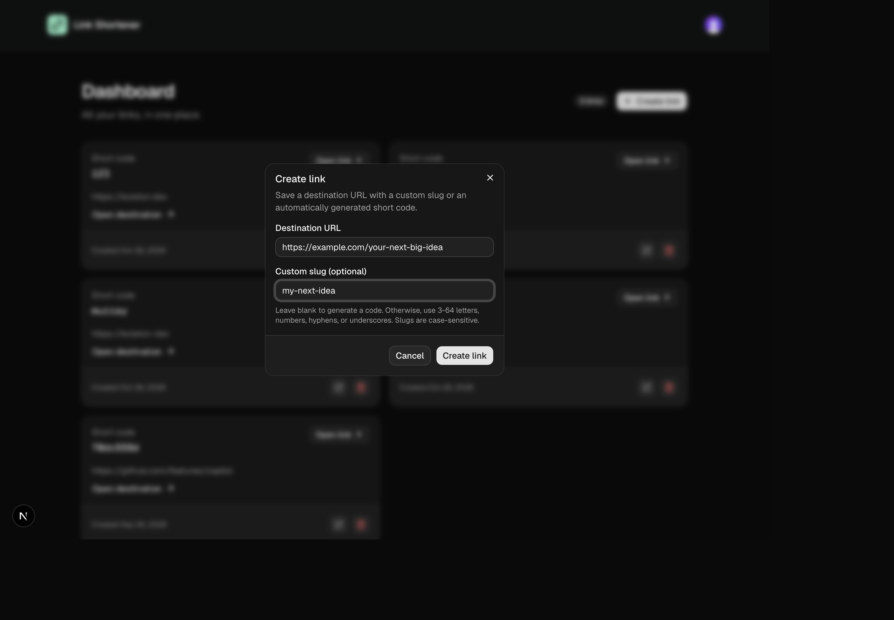

# Link Shortener

[Back to the monorepo](../README.md)

A full-stack URL shortener built with Next.js App Router, React, TypeScript, Clerk, Drizzle ORM on Neon Postgres, shadcn/ui, and Tailwind CSS v4.

## Screenshots

### Public homepage


### Personal dashboard


### Create a link



Screenshots are from local development. The dashboard shows existing development links; the create-link dialog shows an unsubmitted example.

## What we've built

- A responsive, dark landing page with mint accents, feature highlights, and smooth anchor navigation.
- Clerk sign-in and sign-up modals, a profile menu, and themed account controls.
- A protected dashboard that loads only the current user's links, newest first, with a count and empty state.
- Create, edit, and delete dialogs backed by authenticated, validated Server Actions.
- Automatic unique short-code generation or optional, globally unique custom slugs.
- Link cards with destinations, UTC creation dates, short-link and destination buttons, and edit/delete controls.
- Public `/l/[shortcode]` redirects that work without signing in.
- Feature-owned components, server-only database access, shared validation schemas, and colocated tests.
- Project-specific Copilot instructions and a custom instruction-generation agent.

The homepage's link makeover is a labeled static example, not a shortening form or live short link. Signed-in visitors to `/` are redirected to `/dashboard`. Authentication uses modals, not dedicated `/sign-in` or `/sign-up` pages.

## Getting started

### 1. Install dependencies

Use Node.js 22.12 or later and npm. From this directory:

```sh
npm ci
```

### 2. Configure Clerk

Create your own Clerk application or use the tutorial application if you have access. Set these values in an uncommitted `.env.local` file:

```dotenv
NEXT_PUBLIC_CLERK_PUBLISHABLE_KEY=your_clerk_publishable_key
CLERK_SECRET_KEY=your_clerk_secret_key
DATABASE_URL=your_neon_postgres_connection_string
```

Use real values from Clerk and Neon, not the placeholders above. Only the publishable key is intended for client code; keep `CLERK_SECRET_KEY` and `DATABASE_URL` server-side.

Alternatively, the tutorial application can be configured with the Clerk CLI:

```sh
npm install -g clerk
clerk auth login
clerk init --app app_3KcL0cLVmjsziEYaiuPY8qwrwhc
clerk doctor
```

The CLI writes local authentication configuration to `.env.local`. Add `DATABASE_URL` separately.

### 3. Apply the database migration

Create a Neon Postgres database and set its connection string as `DATABASE_URL` in `.env.local`. Apply the checked-in migration:

```sh
node --env-file=.env.local ./node_modules/drizzle-kit/bin.cjs migrate
```

This explicitly loads `.env.local`: [drizzle.config.ts](./drizzle.config.ts) uses `dotenv/config`, which otherwise loads `.env` by default, unlike Next.js's environment-file loading. The migration creates the schema needed by the dashboard.

For future schema changes, generate a migration before applying it:

```sh
node --env-file=.env.local ./node_modules/drizzle-kit/bin.cjs generate
node --env-file=.env.local ./node_modules/drizzle-kit/bin.cjs migrate
```

### 4. Start the app

```sh
npm run dev
```

Open [http://localhost:3000](http://localhost:3000). Create an account or sign in to reach the dashboard, then select **Create link**.

## Link behavior

### Creation and validation

- Destinations must be valid HTTP or HTTPS URLs.
- Leaving the custom slug blank or whitespace-only generates a unique code.
- Custom slugs accept 3-64 letters, numbers, hyphens, or underscores.
- Slugs are case-sensitive and globally unique.
- `dashboard`, `api`, and `_next` are reserved regardless of case.
- Duplicate slugs produce a visible error without creating or changing a link.
- Ownership comes from the Clerk session, never from client input.

### Editing and deleting

Editing opens a prefilled dialog for the destination and short code. The same validation applies, but a short code is required. Deletion requires confirmation and cannot be undone. Cancelling leaves the saved link unchanged.

Listing, updating, and deleting are scoped to the signed-in user. Successful mutations refresh the dashboard list and count; failures remain visible in the dialog for retry.

### Public redirects

Each short code and **Open link** button opens `/l/[shortcode]` in a new tab. The public GET handler looks up the case-sensitive code and returns a temporary **307 redirect** to the saved destination, preserving its path, query, and fragment.

Public lookup returns only the destination and does not require authentication. Invalid or unknown codes return a JSON 404. Responses are not cached, so edits and deletions take effect on subsequent visits.

## Project structure

```text
app/                         Routes, layouts, pages, and loading states
  l/[shortcode]/route.ts      Public short-code redirect handler
components/
  site-header.tsx            Shared site header and account controls
  ui/                        Shared shadcn/ui primitives
features/
  links/
    actions.ts               Authenticated, validated Server Actions
    data.ts                  Server-only, owner-scoped database operations
    schemas.ts               Shared Zod schemas and inferred input types
    schemas.test.ts          Validation tests
    components/              Link cards and create/edit/delete dialogs
db/                          Drizzle client and schema
drizzle/                     Generated database migrations
lib/                         Shared utilities, including the shadcn cn helper
proxy.ts                     Clerk middleware and request redirects
docs/screenshots/            README images reused by the monorepo overview
.github/instructions/        Scoped UI, auth, data, and Server Action guidance
.github/agents/              Custom instruction-generation agent
```

Keep related behavior inside its feature rather than splitting it across top-level data and utility folders. Route files compose feature components. Database access stays in server-only data modules; schemas can be shared with Client Components. Import specific modules to preserve that boundary.

See [AGENTS.md](./AGENTS.md) for development conventions and project commands.

## Checks and production commands

```sh
npm test          # Colocated link-validation tests via Node.js and tsx
npm run lint      # ESLint
npx tsc --noEmit  # TypeScript
npm run build    # Production build
npm start        # Serve the production build
```

The current automated tests cover validation schemas, not end-to-end Clerk flows, live database operations, or browser redirects.

## Security updates

The project uses Next.js 16.4.3. `experimental.agentUpgrade` is set to `"security"` in [next.config.ts](./next.config.ts) to enable security upgrade reminders. From this directory, run `npx next upgrade --agent=security` to prepare a security update; upgrades are not applied automatically.
